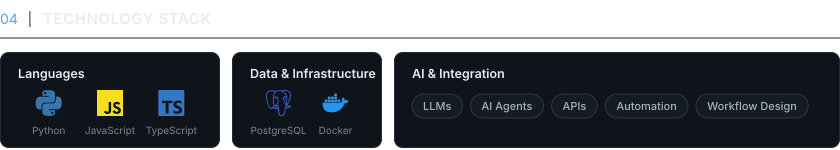
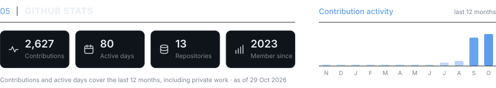

  

 

<picture>
  <source media="(prefers-color-scheme: dark)" srcset="assets/about-dark.svg">
  <source media="(prefers-color-scheme: light)" srcset="assets/about-light.svg">
  
</picture>

  

<a href="https://github.com/shahinamani?tab=repositories">
  <picture>
    <source media="(prefers-color-scheme: dark)" srcset="assets/projects-dark.svg">
    <source media="(prefers-color-scheme: light)" srcset="assets/projects-light.svg">
    
  </picture>
</a>

  

<picture>
  <source media="(prefers-color-scheme: dark)" srcset="assets/stack-dark.svg">
  <source media="(prefers-color-scheme: light)" srcset="assets/stack-light.svg">
  
</picture>

  

<picture>
  <source media="(prefers-color-scheme: dark)" srcset="assets/stats-dark.svg">
  <source media="(prefers-color-scheme: light)" srcset="assets/stats-light.svg">
  
</picture>

  

<a href="https://github.com/shahinamani">
  <picture>
    <source media="(prefers-color-scheme: dark)" srcset="assets/connect-dark.svg">
    <source media="(prefers-color-scheme: light)" srcset="assets/connect-light.svg">
    
  </picture>
</a>
